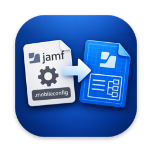
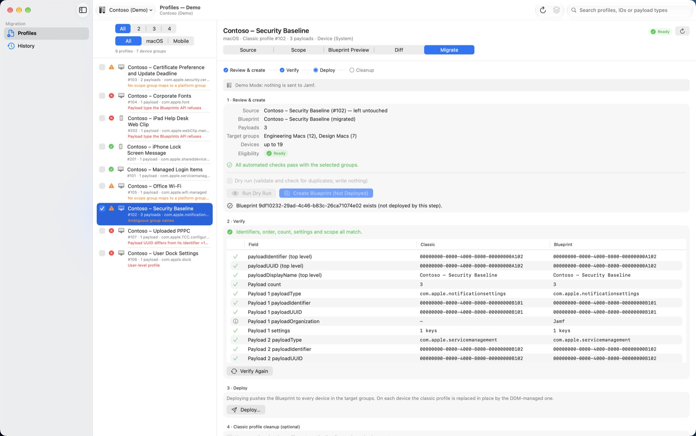
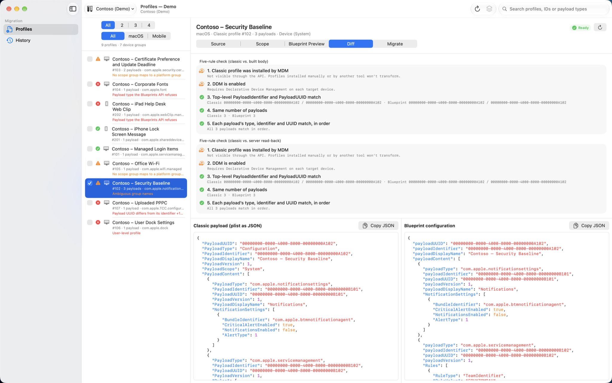

> [!IMPORTANT]
> **Archived.** Profile2Blueprint is no longer maintained. Use Blueshift by Jamf Concepts instead: its Keep as Installed takes a configuration profile over in place using Apple’s transition from MDM, as Profile2Blueprint’s in-place transform does. Blueshift’s README says which profiles qualify for Keep as Installed.
>
> [Open Blueshift](https://github.com/Jamf-Concepts/blueshift)

<p align="center">
  
</p>

# Profile2Blueprint

*Move Jamf Pro classic configuration profiles to Blueprints, safely.*

[](https://github.com/JordyThery/Profile2Blueprint/releases/latest)

[](LICENSE)

A native macOS app that migrates **Jamf Pro classic configuration profiles** (macOS and mobile device) into **Jamf Platform Blueprints**, using the Apple-supported in-place Classic → DDM transform. It turns a manual, API-driven workflow into a safe, reviewable one.



> **Status:** verified end to end against live Jamf tenants — create, server-side verify, deploy, the in-place transform on a Mac and on an iPhone, and classic scope cleanup with restore. Try every migration on a test device before using it fleet-wide.

## Compared with Blueshift

[Blueshift](https://github.com/Jamf-Concepts/blueshift), a Jamf Concepts project, also moves classic configuration profiles to Blueprints, in a different way: it builds a new Blueprint alongside the profile, turns payloads into native declarations where it can and wraps unknown ones as managed preferences, and once you’ve confirmed the Blueprint works, retires the original by renaming and unscoping it. Until then, both manage the same settings. Profile2Blueprint keeps the profile’s payloads as they are and uses Apple’s in-place transform, so the device swaps one for the other with no gap and no second copy. Blueshift suits moving settings to native declarations; Profile2Blueprint suits profiles that must keep applying, unchanged, throughout the migration.

## Install

Download the latest `Profile2Blueprint-X.Y.Z.zip` from [Releases](https://github.com/JordyThery/Profile2Blueprint/releases), unzip it, and move **Profile2Blueprint.app** to `/Applications`. The app is signed with a Developer ID certificate and notarized, so Gatekeeper verifies it instead of blocking it. Requires **macOS 14 or later**.

## Try it without a tenant

Choose **Demo Mode** in the connection picker in the toolbar (or the Connection menu), or click **Try Demo Mode** on the page shown when no tenant is set up. The full flow — eligibility, scope mapping, create, verify, deploy, unscope and restore — runs against a sample tenant, “Contoso (Demo)”, answered inside the app: no tenant is contacted, nothing is saved to your tenants or the Keychain, and there is nothing to configure. Every window title ends in “— Demo” while it is on. This is the quickest way to see whether the app fits your environment.

## Connect to Jamf

In [Jamf Account](https://account.jamf.com), create an API integration scoped to the **platform environment** (tenant scope cannot reach the Blueprints API, and the scope level is fixed once the integration is created). Jamf’s [Integrations Management guide](https://learn.jamf.com/r/en-US/jamf-account-documentation/Integrations_Management_in_Jamf_Account) covers the steps. Grant it:

| Capability | Actions | Needed for |
|---|---|---|
| `device-groups` | Read | Listing platform device groups to map classic scope onto |
| `configuration-profiles` | Read | Reading the classic profiles to migrate |
| `blueprints` | Create, Read, Deploy | Creating, verifying and deploying Blueprints |
| `configuration-profiles` | Update | **Optional**: only to unscope the classic profile after a deployment |

Jamf Account presents these as per-capability checkboxes; the APIs refer to them as `device-groups:read`, `blueprints:create` and so on.

Then in the app, open **Settings › Connections** → **Add Connection…** → pick the region → paste the **Client ID** and **Client secret** → **Load Environments** to pick the platform environment (or paste its **Environment ID**) → **Test Connection** (requests a token, checks that device groups, Blueprints and classic profiles can be read, and counts platform device groups) → **Save**. Secrets are stored only in your Keychain. Optionally add the **Jamf Pro Web Address** you use in a browser to get **Open in Jamf Pro** links for the classic profile and its Blueprint.

## First migration

1. Open **Profiles**. The app contacts the tenant only from here: at launch it opens without a page selected. Every classic profile (macOS and mobile device) is graded **Ready**, **Needs attention** or **Blocked**, with the reasons listed. Filters show one status or one platform at a time; search finds a profile by name, ID or payload type.
2. Select a Ready profile and review the **Scope** and **Blueprint Preview** tabs. Preview shows the exact JSON that will be sent.
3. On the **Migrate** tab, **Run Dry Run** first if you like: it validates and checks for a Blueprint with the same name, and writes nothing. Then click **Create Blueprint (Not Deployed)**. The app reads the Blueprint back and verifies it. Deploying is a separate, explicitly confirmed step.

## How it works

Apple allows a classic (imperative) MDM profile to be transformed in place into a DDM-managed profile — no enforcement gap, no conflict — when all of these hold:

1. The classic profile was installed by MDM.
2. DDM is enabled on the device.
3. The top-level `PayloadIdentifier` and `PayloadUUID` of the DDM legacy profile match the classic profile’s.
4. The number of payloads in `PayloadContent` matches.
5. Each payload’s `PayloadType`, `PayloadIdentifier` and `PayloadUUID` match, in the same order.

The app walks that workflow stage by stage — **fetch → validate → distill (plist → JSON) → map scope → build → create → verify → deploy** — with an explicit confirmation gate before anything irreversible. Rules 1–2 cannot be checked through the API; the app says so and leaves them to you.



## Safety model

- Creating a Blueprint never deploys it.
- Verification compares identifiers, payload order and count, setting values and scope against the server’s read-back, tolerating documented server canonicalization.
- Deploy requires a per-Blueprint confirmation listing the target groups and device count of the Blueprint as verified, and is refused when verification failed or when one of its groups isn’t in the group list (Verify Again first). A group whose device count the server doesn’t give is shown as unknown. Right before deploying, the app reads the Blueprint again: if its steps or scope changed since it was verified, nothing is sent and you verify it again first.
- The HTTP layer refuses any request that isn’t a GET, a Blueprint create, a Blueprint deploy or (only while classic scope changes are on for the tenant) a scope-only classic profile update, before it reaches the network.
- **Classic profile cleanup is opt-in.** After a fully clean deployment (0 failed, 0 pending), the app can unscope the classic profile. This is guarded three times: a per-tenant setting that is off by default, a per-profile opt-in, and a confirmation. Turning the tenant setting off stops every scope change at once, also for migrations still waiting for their device report. The automatic cleanup runs only when the Blueprint’s groups cover every target of the classic scope (each classic group must map, by its exact-name match or the platform group you picked for it on the Scope tab, to one of the Blueprint’s groups; never for “all computers”, individual devices, buildings or departments), and at most once per profile. The original scope is backed up locally, per tenant, and **Restore Scope** puts it back; a restored profile is never unscoped again automatically.
- **Failed Remove commands after cleanup.** Unscoping a classic profile makes Jamf Pro send each device in its old scope a “Remove Configuration Profile” command. On devices with the in-place transform the device refuses it, because the Blueprint now manages the profile, and Jamf Pro keeps retrying. **Deleting the classic profile in Jamf Pro later has the same effect.** For one profile on a few devices the effect is limited; across a large fleet and many profiles the failed commands add up (Jamf [reports](https://github.com/Jamf-Concepts/jamf-cli/blob/main/CHANGELOG.md) a customer with over 100,000 and a Jamf Pro server that ran out of memory). Start with a profile scoped to a small group and watch its failed commands. Jamf Pro can cancel all pending or failed management commands for a group or a search as a mass action ([Mass Actions for Computers](https://learn.jamf.com/r/en-US/jamf-pro-documentation-current/Mass_Actions_for_Computers), [Mass Actions for Mobile Devices](https://learn.jamf.com/r/en-US/jamf-pro-documentation-current/Mass_Actions_for_Mobile_Devices)). Jamf’s documentation doesn’t say whether Jamf Pro sends the Remove command again after you cancel it.
- Client secrets, tokens and request bodies are never written to any log. Copying a request body that holds credentials (Wi-Fi passwords, SCEP challenges) keeps it off other devices and clipboard history, and clears it after a minute.
- The app contacts only the Jamf Platform API gateway of the tenant’s region (`us.api.jamfcloud.com`, `eu.api.jamfcloud.com` or `apac.api.jamfcloud.com`, or the host override you set) and GitHub: once a day to ask whether a newer release exists (`api.github.com`), and to download one when you choose to. Turn the update check off in **Settings › Updates**. Demo Mode contacts no tenant.
- Never undeploy a Blueprint in Jamf Pro after the classic profile is gone: that removes the settings from devices. (The app itself can’t undeploy anything.)

## Other features

- **Multiple tenants**: us / eu / apac, with an optional host override, in Settings › Connections.
- **Blueprint name and description**: a per-tenant name prefix and suffix, and a description template with `{name}` (the profile’s name), `{id}` (its Jamf Pro ID) and `{platform}` (“macOS” or “mobile device”) tokens. All three are optional and default to the original wording, so a test environment can be labeled differently from production; an empty template means no description. Both stay editable per Blueprint before creating.
- **Dry run**: **Run Dry Run** validates, builds the request and checks for a Blueprint with the same name, and writes nothing.
- **Duplicate names**: when a Blueprint with the same name exists, choose **Skip**, **Rename** or **Open Existing**.
- **Scope mapping**: exact-name auto-matching against platform groups of the profile’s own platform (a mobile profile is never offered a computer group), with pickers for anything ambiguous or unmatched.
- **Diff**: the five rules as a checklist, plus side-by-side JSON.
- **Credentials warning**: a profile that holds credentials is marked “Contains credentials”, and its preview says to treat copies as secrets.
- **Batch migration**: tick profiles in the list (or ⌘-click), then **Profile › Migrate Selected…** (⇧⌘M) to review them together: per-item summaries, a dry run or create for all of them, **Stop** during a run, and one deploy confirmation listing every target.
- **Reload and Reload Profile**: read the list or one profile again; open migrations that haven’t created their Blueprint yet pick up the change.
- **Open in Jamf Pro**: the configuration profile or its Blueprint, in the Jamf Pro console.
- **Update check**: daily and on demand, with release notes and a download.
- **Persistent sessions**: a created Blueprint re-attaches after a relaunch and resumes at its current stage; after a deployment the device report refreshes every 20 seconds for up to 30 minutes, then **Refresh Status** checks again. When the Blueprint was deleted on the server, the saved reference is removed.
- **History**: every migration action, with the selected action’s details beside the list, exportable as Markdown or JSON (**File › Export History**, ⇧⌘E). A failed or stopped deploy says whether it may have started.
- **Menu commands**: **Profile › Reload Profiles** (⌘R), **Reload Profile** (⇧⌘R), **Migrate Selected…** (⇧⌘M) and **Open Profile / Blueprint in Jamf Pro** (⌥⌘J, ⇧⌥⌘J).
- **Activity Log** (Window › Activity Log, ⇧⌘L): everything the app does: token requests, every API call (status, duration, trace ID), retries, refused writes and settings changes. It keeps the last 10,000 entries while the app runs.
- **Retry waits**: when Jamf asks the app to wait before trying a request again (at most 60 seconds), the Migrate tab and batch migration show the wait, with **Stop** to end it at once.

## Where your data is stored

The app is sandboxed, with outgoing network connections only, plus read and write access to the files you choose when exporting History. Its data is in `~/Library/Containers/be.jordythery.profile2blueprint/Data/Library/Application Support/Profile2Blueprint/`:

- `tenants.json`: your tenants and the one in use.
- `history.json`: the migration history.
- `scope-backups.json`: the original classic scopes, for **Restore Scope**.
- `sessions.json`: migrations in progress, so they resume after a relaunch.

Client secrets are in your Keychain, under the service `be.jordythery.profile2blueprint.oauth-client-secret`. A file the app can’t read is kept as `<file>.unreadable-<date and time>` and never written over. Demo Mode saves nothing to these files.

## Build from source

Requires Xcode 27 or later (Swift 6, strict concurrency). Open `Profile2Blueprint.xcodeproj` and run the `Profile2Blueprint` scheme. `⌘U` runs the unit tests.

The app’s only package dependency is [JTKit](https://github.com/JordyThery/JTKit), the shared package of these apps, resolved from GitHub. Resolving it also downloads Microsoft’s MSAL, which JTKit uses for Intune sign-in and which this app doesn’t link or ship.

```
Profile2Blueprint/
  App/        AppModel, Workspace, MigrationSession, HistoryLog,
              ActivityEntries, DemoFiles, Log
  Models/     Tenant, ClassicProfile, PlistValue (order-preserving),
              ProfilePlatform, EligibilityReport, MigrationRecord,
              Blueprint (the create request), APIError, LosslessJSON+App
  Services/
    Auth/        KeychainStore (where the client secrets are kept)
    API/         RequestPolicy (allow-list), ClassicAPI, ClassicScopeWriter
    Migration/   PlistParser, ClassicXMLParser, PlistToJSON, ScopeMapper,
                 EligibilityChecker, BlueprintBuilder, FidelityVerifier,
                 MigrationPipeline (actor, staged state machine),
                 ClassicScopeService (with ScopeBackupStore)
    Persistence/ TenantStore, HistoryStore, SessionStateStore, StoredList
  Features/    Connect, ProfileList, ProfileDetail, ScopeMapping, Review,
               Deploy, Batch, History, Shared
  Resources/   Fixtures (Contoso demo profiles and the demo Classic server)
Profile2BlueprintTests/     Swift Testing suite, on JTKit’s fake network
Profile2BlueprintUITests/   Demo Mode smoke tests (run by the release check)
```

The Platform API client, sign-in, Blueprints, device groups, the activity log, About, Settings, the update check and Demo Mode come from JTKit.

Demo mode uses JTKit’s demo network and Jamf Platform server, with the app’s Classic profiles added to it, so the same client, allow-list, pipeline and UI run in demo mode as against a tenant.

## Known limitations

- Scope limitations and exclusions have no Blueprint equivalent and aren’t carried over (the eligibility checker warns about this).
- User-level profiles can’t be migrated.
- Sites aren’t carried over: the public Blueprints API has no site field yet.
- Jamf School isn’t supported: its platform environment offers no configuration profiles or device groups, so profiles can’t be read and a Blueprint can’t be scoped.
- A local Jamf Pro account can’t be used: Blueprints exist only behind the Jamf Platform API gateway, which needs a Jamf Account integration.
- A payload whose `PayloadUUID` differs from its `PayloadIdentifier` is blocked: the Blueprints API overwrites the UUID with the identifier, so the transform would fail on devices. Typical of uploaded profiles; a clone made in Jamf Pro gets matching identifiers.
- 22 payload types are refused by the Blueprints API and are flagged as blocked before anything is sent — certificates and SCEP, VPN and per-app VPN, Extensible SSO, directory binding, legacy MCX FileVault, global HTTP proxy, web content filter, DNS settings, fonts and web clips among them. The payload-type tables come from Jamf’s own [`jamf-cli`](https://github.com/Jamf-Concepts/jamf-cli/tree/main/internal/profileconvert), which wire-probed them; they are instance- and version-specific, so the API remains the authority.
- A payload type Jamf Pro spells differently from Apple (currently `com.apple.preferences.users`) blocks migration. Rewriting the type would break the rule that every payload type matches the installed profile.
- The classic scope update (`PUT /proclassic/{resource}/id/{id}`) uses the Classic API’s partial-XML convention. Jamf’s OpenAPI specs don’t document the request body; both the macOS and the mobile form are verified against a live tenant.

## Support

If Profile2Blueprint saves you time, you can [buy me a coffee](https://buymeacoffee.com/jordythery). ☕️

## Disclaimer

This tool is provided as-is, without warranty of any kind. Use it at your own risk. This is a personal project. It is not affiliated with or endorsed by my employer, Jamf or Apple. Issues and pull requests are appreciated. Support is best-effort.

## License

[MIT](LICENSE)
